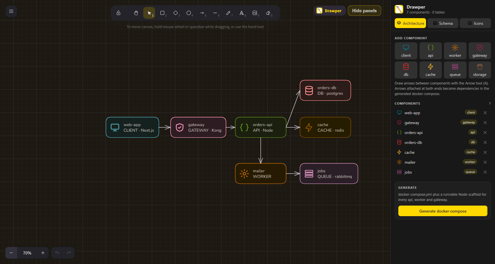
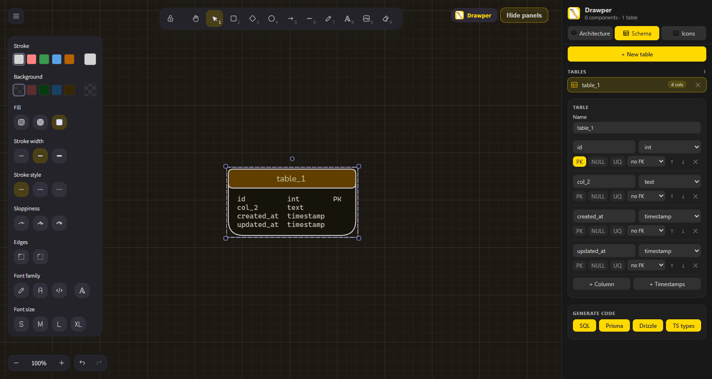
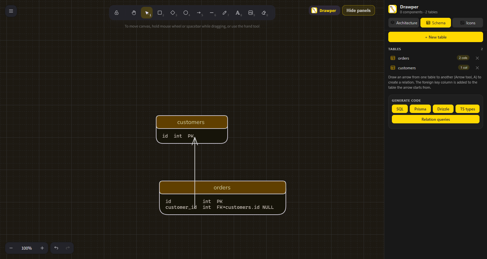
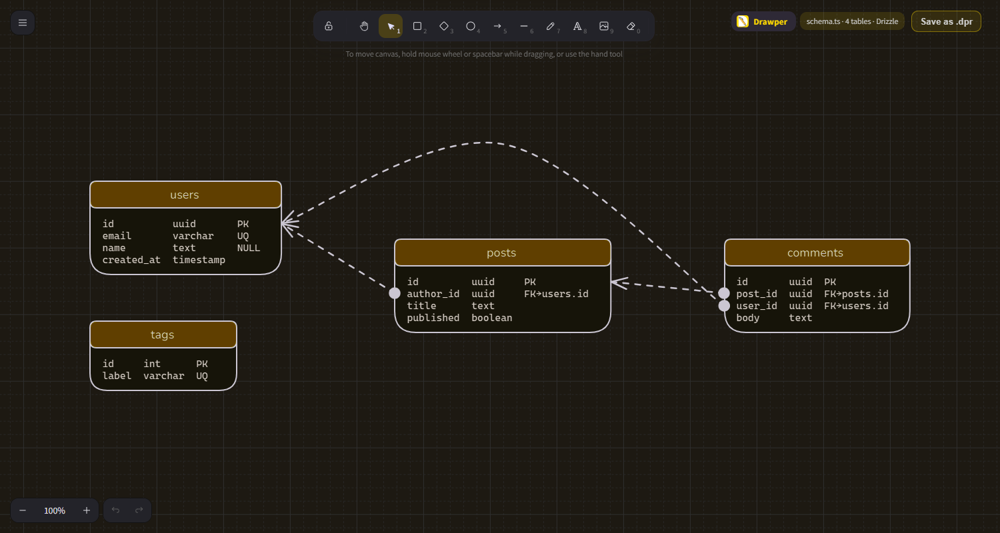

<p align="center">
  
</p>

<h1 align="center">Drawper</h1>

<p align="center">
  A fast whiteboard canvas inside VS Code for sketching system architecture and database schemas,<br/>
  then turning them into real code.
</p>

<p align="center">
  
  
  
</p>

---

## Demo

<p align="center">
  
</p>

## Screenshots

**Architecture canvas.** Drop components, connect them with arrows, generate a runnable `docker-compose`.



**Schema editor.** Design tables and columns visually and export them as SQL, Prisma, Drizzle or TypeScript.



**Relations with arrows.** Draw an arrow from one table to another and Drawper adds the foreign key column for you. The arrow starts at the table that holds the key and points at the table it references.



**Schema viewer.** Open any file that defines tables and see an ER diagram with foreign keys drawn for you.



## Features

- **Opens fast.** Code-split webview (about 750 KB up front), the document is embedded in the page, and the extension only activates when you use it.
- **Architecture panel.** Client, API, worker, gateway, database, cache, queue and storage components. Arrows between them become dependencies.
- **Schema panel.** Visual table and column editor with primary keys, nullable, unique and foreign keys. Renaming a table or column updates every foreign key that points at it.
- **Relations by arrow.** Join two tables with an arrow and the foreign key is created, then flows into every generator.
- **Code generation.** SQL, Prisma, **Drizzle** (with `relations()`), TypeScript types and `docker-compose.yml` with a Node scaffold per service.
- **Relation queries.** One click writes ready-to-run SQL joins plus Drizzle and Prisma relation queries for every relation.
- **Convert code from the IDE.** Turn an existing schema file into another format without opening the canvas. See [Convert code](#convert-code-from-your-ide).
- **Schema viewer for existing code.** A CodeLens appears above schema definitions: **View in Drawper**. It shows the file's tables plus related tables from other files (foreign keys are followed across imports), and a **Whole app** toggle shows every schema in the workspace. "Go to" jumps to the right file.
- **Draw on your code.** **Canvas** (editor title bar, status bar or above a selection) opens the whole file as a live, locked card on `<file>.annotations.dpr` beside the editor, with pens, arrows and notes on top. Those drawings are also shown over the real editor (display only; relies on an unofficial VS Code trick, tune `drawper.overlay.charWidthRatio` if it drifts sideways, or turn it off with `drawper.overlay.enabled`). **Add to canvas** drops just the selected code on a canvas as a card. Paste screenshots with `Ctrl+V`.
- **Icons and SVG.** Built-in icon library, SVG import, and paste SVG markup straight onto the canvas.
- **Resizable side panel.** Drag its left edge; the width is remembered.
- **Panel themes.** Pick Blue, Yellow, Mint, Coral or Violet from the Theme button in the panel header; the choice is remembered.
- **Plain JSON files.** Drawings are saved as `.dpr` and diff cleanly.

### Schema sources the viewer understands

| Source | Detected from |
| --- | --- |
| Prisma | `model X { ... }` |
| SQL | `CREATE TABLE` and `ALTER TABLE ... FOREIGN KEY` |
| Drizzle | `pgTable`, `mysqlTable`, `sqliteTable`, `singlestoreTable`, `mssqlTable`, `schema.table(...)`, composite `primaryKey` and `foreignKey` |
| TypeORM | `@Entity()` classes |
| SQLAlchemy | `__tablename__` models |
| Django | `models.Model` classes |
| Mongoose | `new Schema({ ... })` |

### Generate targets

| Target | Output |
| --- | --- |
| SQL | `schema.sql` |
| Prisma | `schema.prisma` |
| Drizzle | `schema.ts` (`drizzle-orm/pg-core`) |
| TS types | `types.ts` |
| Relation queries | `queries.sql`, `queries.drizzle.ts`, `queries.prisma.ts` |
| docker-compose | `docker-compose.yml` and `services/<name>/` |

Files are written next to your drawing in `<name>-generated/`.

## Relations and queries

Draw an arrow with the Arrow tool (`A`) between two tables. Drawper adds a `<table>_id` column to the table the arrow starts from, with a foreign key to the primary key of the table it points at. Existing foreign keys are never duplicated, and the same relation flows into SQL, Prisma, Drizzle and TypeScript output.

**Relation queries** turns every relation into both directions of a join:

```sql
-- orders -> customers (many-to-one), columns shortened here
SELECT
  orders.id AS orders_id,
  orders.customer_id AS orders_customer_id,
  customers.id AS customers_id
FROM orders
LEFT JOIN customers ON orders.customer_id = customers.id;
```

```ts
await db.query.orders.findMany({ with: { customer: true } });      // Drizzle
await prisma.order.findMany({ include: { customer: true } });      // Prisma
```

## Convert code from your IDE

You do not need a canvas to convert a schema. Open any file that defines tables (Prisma, SQL, Drizzle, TypeORM, SQLAlchemy, Django or Mongoose) and use any of these:

| Where | How |
| --- | --- |
| CodeLens above the first table | **Convert to Drizzle / Prisma / SQL…** |
| Right-click in the editor | **Drawper: Convert Schema To…** |
| Right-click a file in the Explorer | **Drawper: Convert Schema To…** |
| Command Palette (`Ctrl+Shift+P`) | **Drawper: Convert Schema To…** |

Pick a target (Drizzle, Prisma, SQL, TypeScript types or Relation queries) and the converted code opens beside your file, saved in `<file>-converted/`.

For example, a Prisma schema becomes Drizzle with its relations in two clicks, and a TypeORM or Django model becomes SQL.

## Getting started

```bash
git clone https://github.com/Vaibhav9526/Drawper.git
cd Drawper
npm install
npm run compile
```

Then press **F5** in VS Code to launch the Extension Development Host.

To build an installable package:

```bash
npm run package   # produces drawper-<version>.vsix
code --install-extension drawper-0.1.0.vsix
```

## Usage

| Command | What it does |
| --- | --- |
| `Drawper: New Drawing` | Creates `sketch-N.dpr` in the workspace and opens it |
| `Drawper: Open Drawing Canvas` | Opens the current `.dpr`, or lets you pick one |
| `Drawper: View Schema in This File` | Shows an ER diagram for the schema in the active file |
| `Drawper: Convert Schema To…` | Converts the schema in the active file to Drizzle, Prisma, SQL, TS types or relation queries |

1. Run **Drawper: New Drawing**.
2. Add components or tables from the side panel.
3. Draw arrows between components with the Arrow tool (`A`).
4. Click a generate button to write code.

## Development

```bash
npm run compile            # tsc for src/, esbuild bundle for src/webview into media/dist
npm run watch              # tsc --watch (extension host)
npm run watch:webview      # esbuild --watch (webview)
npm run typecheck:webview  # type-check the webview
npm test                   # compile, then parser tests and generator round-trip tests
```

### Project structure

```
Drawper/
├── src/
│   ├── extension.ts       # activation, custom editor, schema CodeLens, webview host
│   ├── model.ts           # .dpr document model, arrow-to-relation detection
│   ├── relations.ts       # foreign keys from arrows, relation naming
│   ├── codegen.ts         # SQL / Prisma / Drizzle / TS / queries / docker-compose generators
│   ├── schemaParsers.ts   # Prisma, SQL, Drizzle, TypeORM, SQLAlchemy, Django, Mongoose
│   └── webview/           # React UI: canvas, side panel, shapes, icons
├── media/
│   └── brand/             # logo.svg (source) and logo.png (marketplace icon)
├── docs/images/           # README screenshots
└── scripts/               # webview build and parser tests
```

## Brand

| | |
| --- | --- |
| Blue | `#005FFF` |
| Ink | `#2E2936` |
| Yellow | `#FFD900` |
| Coral | `#EC5451` |
| Mint | `#87DAC7` |
| Violet | `#8B5CF6` |

## License

[MIT](LICENSE)
